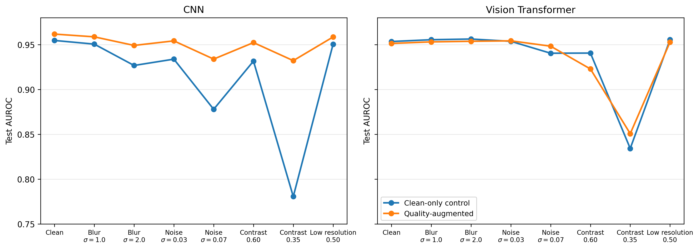

# Quality-Aware Augmentation for Robust Pneumonia Classification

Can quality-aware data augmentation improve pneumonia classification robustness on degraded chest X-rays without reducing performance on clean images?

This project trained a compact residual CNN and a compact Vision Transformer (ViT) on PneumoniaMNIST. Each architecture was trained as a clean-only control and with moderate, label-preserving quality augmentation: Gaussian blur, Gaussian noise, contrast reduction, or reduced resolution.

## Main result

Quality-aware augmentation improved the CNN's mean AUROC across seven degraded test conditions from **0.907** to **0.948**, while clean-test AUROC increased from **0.955** to **0.962**. For the ViT, clean AUROC changed from **0.953** to **0.951** and mean degraded AUROC remained **0.934**. In this single-seed benchmark, the augmentation benefit was therefore architecture-dependent.



## Experimental design

| ID | Architecture | Training policy |
| --- | --- | --- |
| C0 | CNN | Clean-only control |
| C1 | CNN | Quality-aware augmentation |
| T0 | Vision Transformer | Clean-only control |
| T1 | Vision Transformer | Quality-aware augmentation |

The held-out test images were evaluated clean and under blur, noise, contrast, and low-resolution corruptions. AUROC was the primary metric.

## Repository layout

```text
src/            CNN, ViT, and result-figure source code
data/           Local PneumoniaMNIST NPZ archive (not tracked)
data_preview/   GitHub-viewable class summary and sample chest X-rays
assets/         Figures displayed in this README
results/runs/   Metrics, predictions, and figures from four completed runs
lectures/       Lectrace presentation source and assets
scripts/        Dataset-preview generation utility
```

## Setup

```bash
python3 -m venv .venv
source .venv/bin/activate
pip install -r requirements.txt
```

Download `pneumoniamnist_128.npz` from the official [MedMNIST v2 project](https://medmnist.com/) and save it as `data/pneumoniamnist_128.npz`. The source archive is intentionally excluded from Git; see [data/README.md](data/README.md).

## Run an experiment

```bash
# CNN: clean-only control and quality-augmented treatment
python src/cnn_model.py --run-name cnn_baseline
python src/cnn_model.py --quality-augmentation --run-name cnn_augmented

# ViT: clean-only control and quality-augmented treatment
python src/transformer_model.py --run-name transformer_baseline
python src/transformer_model.py --quality-augmentation --run-name transformer_augmented
```

Each run writes its metrics, predictions, and plots to `results/runs/`. Large model checkpoints are kept locally and excluded from Git.

## Lectrace presentation

```bash
pip install -r lectures/requirements.txt
lectrace serve --port 7001 lectures/01_pneumonia_robustness.py
```

Open `http://localhost:7001` while the process is running.
