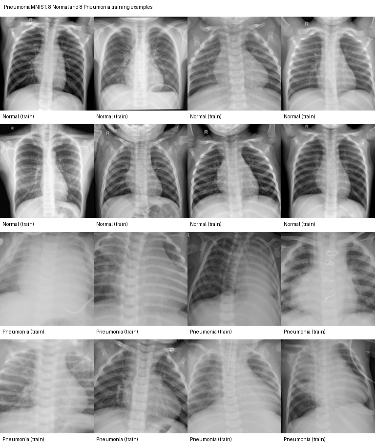

# Dataset preview

The full PneumoniaMNIST data are stored locally as a binary `.npz` file and are intentionally excluded from this repository. This folder contains a small, non-sensitive preview that GitHub can render directly.

## Random training examples

Eight Normal and eight Pneumonia chest X-rays were selected with a fixed random seed for reproducibility.



## Split and class summary

The GitHub-viewable [dataset summary](dataset_summary.csv) reports the number and proportion of Normal and Pneumonia images in each split.

## Reproduce this preview

After placing `pneumoniamnist_128.npz` in `data/`, run:

```bash
.venv/bin/python scripts/create_data_preview.py
```
